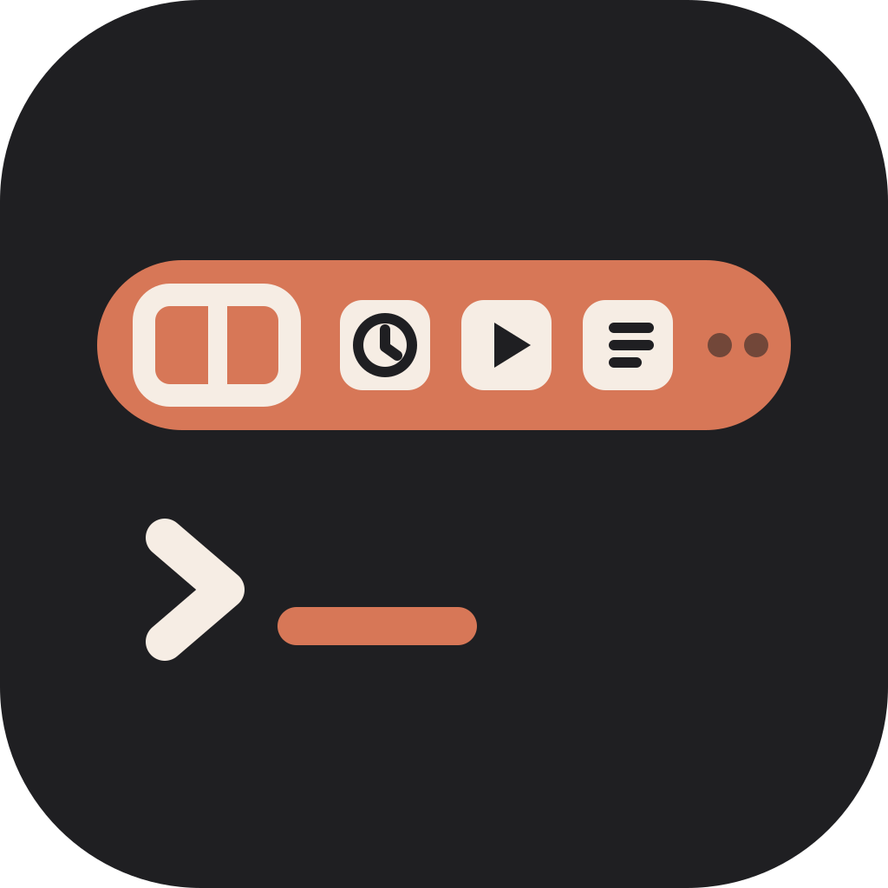
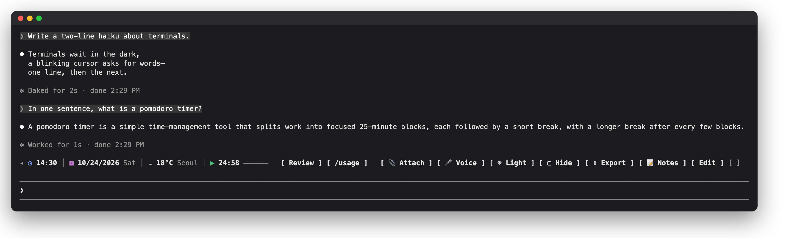
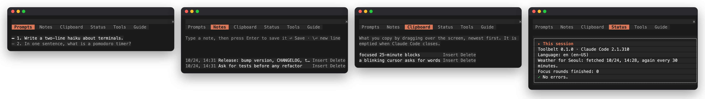

<p align="center">
  <b>English</b> · <a href="README.ko.md">한국어</a> · <a href="README.ja.md">日本語</a>
</p>

<p align="center">
  
</p>

<h1 align="center">Oh My Toolbelt</h1>

<p align="center">
  <b>New to the terminal? Claude Code, made easy.</b><br>
  Your go-to prompts as buttons, files attached from a picker, passing thoughts kept as notes. All on one toolbelt, right above the prompt box.
</p>

When you use Claude Code in a terminal, an unfamiliar screen and missing conveniences can often leave you at a loss. Oh My Toolbelt is a toolbelt built around the things a non-developer found awkward in the terminal.

Add a single toolbelt row above the prompt box, and the commands and prompts you use most become buttons. Attaching a file no longer means typing its path: you pick it in a file picker. An idea that comes up mid-task goes into a note, and from there straight into the prompt box. Prompts you sent earlier are in a list too; click one to jump right back to it. When you step away, **Hide** covers your work, and **Export** saves the session's conversation to a file in one go.

The little things that trip you up when the terminal is new, eased by one toolbelt. Most of it works the same in the desktop app, too.

<p align="center">
  <a href="LICENSE"></a>
  
  
  
</p>



**From a terminal:**

```sh
claude plugin install oh-my-toolbelt --marketplace calmtiger86/oh-my-toolbelt
```

One line. If Claude Code is already open, type `/reload-plugins` there to turn it on. If the install ends with `userConfig options not yet set`, that is fine: every setting starts at its default. It starts quiet: no network until you pick a weather city, no clipboard history until you turn it on, and nothing you write in it leaves your computer unless you send it as a prompt.

**In the desktop app:** open **+** → **Add plugins** (or **Plugins** → **Browse plugins**), add the marketplace from its repository, `calmtiger86/oh-my-toolbelt`, then pick oh-my-toolbelt in the list and install it. Running the terminal command above once works too: the terminal and the desktop app's local sessions read the same settings.

<details>
<summary><b>Install in detail: requirements, updating and removing</b></summary>

**Requirements:** Claude Code 2.1.309 or later, in a terminal or in the desktop app's Code tab. VS Code and mobile do not draw a row above the prompt.

From a terminal:

```sh
claude plugin install oh-my-toolbelt --marketplace calmtiger86/oh-my-toolbelt
```

Inside Claude Code:

```
/plugin install oh-my-toolbelt --marketplace calmtiger86/oh-my-toolbelt
```

It asks to add the marketplace (`y`) and the scope (Enter), then shows the settings: press Enter on each row to keep its default, then Save.

To update: `claude plugin update oh-my-toolbelt`, then restart Claude Code; what changed is in [CHANGELOG.md](CHANGELOG.md). To remove: `claude plugin uninstall oh-my-toolbelt`.

</details>

## Features

| Feature | What it does |
|---|---|
| **Your buttons** | Save the prompts and commands you use most as buttons. A press puts one in the prompt box or sends it |
| **Prompt list** | The prompts you sent pile up in a numbered list; click one to go back to it |
| **Attach** | Pick files in your file picker; they go into the prompt box as `@` mentions (terminal) |
| **Notes** | Jot down a thought and put it in the prompt box later. All your sessions share the same notes |
| **Clipboard history** | Keeps what you copy from the conversation so you can put it back (off by default; only in the desktop app and in the terminal's fullscreen mode) |
| **Hide** | One press covers the conversation |
| **Export** | Saves the conversation as a Markdown, HTML or text file; in the terminal, as PDF too once you pick a Chromium-based browser as the **PDF browser** and PDF as the **Export format**, both in the **Status** tab |
| **Clock · Date · Weather** | The clock and date stay in view; pick a city and the weather shows too (weather is off by default) |
| **Pomodoro** | Shows a focus round with a progress bar and tells you when it ends |
| **Voice** | Turns Claude Code's voice input on and off (terminal) |
| **Light / Dark** | Switches the theme |
| **Fold** | `◂` folds the whole toolbelt into a single `▸` |
| **Panel** | Opens from **Edit** or `/toolbelt`, with the settings, the button layout and a step-by-step guide |

## Quick start

1. Look under the conversation: the toolbelt is the row right above the prompt box.
2. Press **Edit**, open the **Guide** tab and follow part 1. It takes two minutes.
3. Make it yours in the **Status** tab: pick a weather city, turn on the **Clipboard tab**, choose 12 or 24 hours.



## In detail

**New here? Start with the guide.** Press **Edit** on the toolbelt and open the **Guide** tab: it walks you through each feature step by step and tells you what to press. The guide speaks the language you set (English, Korean or Japanese).

<details>
<summary><b>The toolbelt and the panel, tool by tool</b></summary>

### On the toolbelt

Information on the left, buttons on the right. When the window is narrow, the buttons shrink to their icons and the least needed ones move into `…`.

| Tool | What it does |
|---|---|
| `◂` / `▸` | Fold the toolbelt into a single `▸`, and open it again. It stays folded next time |
| Clock · Date | 12- or 24-hour, in your computer's time zone, UTC or that of one of 53 cities, seconds if you like; the date in your language's order |
| Weather | Off until you pick one of 63 cities. Current conditions, refreshed every 30 minutes by default |
| Pomodoro | Press it to start a focus round, again to pause, once more to go on. Breaks are timed only when Pomodoro auto break is on. A notification when a round ends, and a sound on macOS if you turn it on |
| Your buttons | A saved prompt to put in the prompt box or send, or a slash command or skill to run. Group them into sets and switch between sets |
| Attach | Your system's file picker; the files go into the prompt box as `@` mentions (terminal) |
| Voice | Turns Claude Code's voice input on and off, where your Claude Code has `/voice` (terminal) |
| Light / Dark | Switches Claude Code's theme to its light or dark pair |
| Hide | Covers the conversation until you press it again |
| Export | Saves the conversation in the format picked in the Status tab (Markdown at first) |
| Notes | Opens the notes |
| Edit | Opens the panel |

### The panel

Press **Edit** or type `/toolbelt` to open it beside the conversation.

| Tab | What it holds |
|---|---|
| Prompts | Every prompt you sent in this conversation, numbered (the newest 200). Click one to jump to it. Point at one to see its turn on the toolbelt row: how long it took, the tools it used and the files it changed. In the desktop app a row opens in place: read the whole answer, put the prompt back in the prompt box, or export that answer alone |
| Notes | A notepad shared by all your sessions. Insert puts a note at the cursor of the prompt box. Up to 500 notes (256 KiB); past that the oldest go |
| Clipboard | Off by default. What you copy by dragging over the conversation, newest first (the last 30; a selection over 20,000 characters is skipped); Insert puts it back. Kept in memory until Claude Code closes, never written to a file |
| Status | This session at a glance (versions, weather, finished focus rounds, the last error), every tool, and every setting as a switch or a pick list |
| Tools | The layout (side, order, shown or hidden), your buttons and button sets, and the icons |
| Guide | A step-by-step tour of all of the above, in your language |

</details>

<details>
<summary><b>Commands and shortcuts</b></summary>

In the terminal, press `ctrl+x`, let go, then `tab`: the toolbelt is selected. Tab moves between buttons, Enter presses one, Esc goes back to the prompt box. While it is selected, one letter presses a tool (`a` Attach, `v` Voice, `t` Light / Dark, `h` Hide, `e` Export, `n` Notes, `b` Edit, `m` more); your own buttons can have letters too. In the desktop app, click the buttons.

| Command | What it does |
|---|---|
| `/toolbelt` (or `/tb`, when no other mod has it) | Open the panel |
| `/toolbelt tools` · `toc` · `notes` · `clips` · `status` · `guide` | Open the panel at that tab |
| `/toolbelt toc next` · `prev` · `first` · `last` · `<n>` · `find <words>` | Jump to a prompt |
| `/toolbelt pomodoro start` · `pause` · `stop` · `reset` | Start or go on, pause, stop (the count of finished rounds stays) or reset (the count goes back to 0) |
| `/toolbelt export [md\|html\|txt\|pdf]` | Export the conversation |
| `/toolbelt curtain on` · `off` | Hide or show the conversation |
| `/toolbelt weather refresh` | Fetch the weather now |
| `/toolbelt hide` · `show` | Take the toolbelt away entirely, or bring it back |

</details>

<details>
<summary><b>Settings</b></summary>

Every setting is a switch or a pick list in the panel's **Status** tab; all but the export format are in `/config` too.

| Setting | Default | Choices |
|---|---|---|
| `language` | `auto` | `auto` (your system's), `en`, `ko`, `ja` |
| `clockFormat` · `clockSeconds` | `auto` · off | `auto`, `12`, `24`; seconds on or off |
| `dateFormat` | `auto` | `off`, `auto`, year first, day first, month first |
| `timeZone` | `system` | Your computer's zone, `UTC`, or one of 53 cities |
| `iconStyle` | `icon+label` | `icon+label`, `icon`, `label` (for terminals that draw emoji badly) |
| `weatherPlace` | `off` | `off` or one of 63 cities |
| `temperatureUnit` · `weatherRefreshMinutes` | `auto` · `30` | `auto` (Fahrenheit for US cities), Celsius or Fahrenheit; 10 to 180 minutes |
| `pomodoroFocusMinutes` · `pomodoroBreakMinutes` | `25` · `5` | 5 to 120; 1 to 60 |
| `pomodoroAutoBreak` · `pomodoroNotify` | off · on | Start the break when a focus round ends (without it no break is timed); notify when a round ends |
| `pomodoroSound` · `pomodoroSoundName` | off · `bell` | A sound when a round ends (macOS): `bell`, `chime`, `ding`, `digital`, `marimba`, `soft` |
| `exportDirectory` · `pdfBrowser` | `downloads` · `off` | Where exports go (`downloads`, `desktop`, `documents`, `home`, or `session`: the project folder, where a file could end up in git); the browser that prints PDFs (`auto`, `chrome`, `edge`, `brave`, `chromium`) |
| Export format (Status tab only) | `md` | `md`, `html`, `txt`, and `pdf` in the terminal once `pdfBrowser` is set |
| `attachEnabled` · `voiceMode` | on · `tap` | The Attach button; how Voice records (`tap` or `hold`) |
| `curtainRestoreOnSubmit` | off | Show the conversation again when you send a prompt |
| `hotkeysEnabled` | on | Letter keys for the toolbelt's buttons |
| `tocTab` · `clipboardTab` | on · off | The Prompts tab; the Clipboard tab |
| `paneOpenOnStart` | off | Open the panel when a session starts (wide windows) |

</details>

**Privacy:** Oh My Toolbelt runs on your computer and sends nothing about you to its authors; its only network request is the weather, if you turn it on.

<details>
<summary><b>Privacy, point by point</b></summary>

- **Network:** only the weather, and only after you pick a city. `api.open-meteo.com` receives that city's coordinates and the temperature unit; like any web request, it also sees your IP address.
- **Your conversation:** while the Prompts tab is on (the default), it reads the prompts you send, what each turn did (tool names, edited files, time) and this session's transcript file, to list your prompts; Export writes the conversation to a file you asked for, keeping the commands you typed but not their output or the hidden text Claude Code puts ahead of your prompts. Neither leaves your computer.
- **Stored on this computer:** your buttons, layout, icons, notes, the pomodoro, the weather cache, a few preferences and the transcript file paths of your 20 most recent sessions, recorded while the Prompts tab is on (on by default), as plain text in Claude Code's plugin store. The clipboard history stays in memory only. While Claude Code runs, other mods you installed can read your notes, buttons and clipboard history.
- **Programs it starts:** your file picker when you press Attach and a browser when you export a PDF; by itself, while the Prompts tab is on, `tail` (PowerShell on Windows) to read this session's transcript when it is over 4 MiB. Each with an argument list and no shell.
- **The model** sees only what you choose to send: a prompt button you press, or a note, clip, earlier prompt or attached file you put in the prompt box. The one-line reply of a `/toolbelt` command stays in the conversation, where the model can read it.

The full account is in [PRIVACY.md](PRIVACY.md).

</details>

<details>
<summary><b>Limitations</b></summary>

- **Desktop app:** no Attach or Voice button (its prompt box has its own), no PDF export, and a pomodoro alert is a message in the app. Clicking a prompt opens it in place instead of scrolling, as Claude Code lets no mod move the conversation there. Settings changed in its Status tab apply at once and are kept by the toolbelt; they are copied to `/config` the next time you use it in the terminal.
- **Clipboard tab:** collects in the desktop app and where Claude Code draws the whole terminal screen (`"tui": "fullscreen"`); in the inline layout your terminal app does the selecting, so nothing reaches the toolbelt.
- **Hide** covers the conversation but not the lines Claude Code draws itself, such as the logo and notices.
- **Hide and your buttons:** with `curtainRestoreOnSubmit` off, a prompt sent by one of your send buttons stays in view (its answer is covered), as Claude Code does not pass that prompt's row to the mod that sent it.
- **Export:** a prompt that starts like one of Claude Code's own tags (such as `<command-name>` or `<bash-stdout>`) can be left out of an export, as it cannot be told apart from Claude Code's output.
- **Prompts tab:** the turn details shown for a prompt count only the turn that prompt started. The answer to a `!` shell command (bash mode), a follow-up turn Claude Code starts by itself after something you do, and a turn started by another mod, by one of your buttons that runs a command or skill, or by a task notification count toward no prompt. In an older conversation whose transcript file records no turn lengths, such a turn may still count toward the prompt before it.
- **Tested on** macOS with Claude Code 2.1.309 and 2.1.310, in the terminal and the desktop app. The automatic tests run on Linux and Windows too; the file pickers there have not been tried by hand.

</details>

<details>
<summary><b>Troubleshooting</b></summary>

- **No toolbelt?** Run `/plugin` and check that oh-my-toolbelt is listed as active. In a narrow window the toolbelt shrinks, and below about 14 columns it steps aside.
- **Something failed?** The panel's **Status** tab shows the last error in plain words. For the full record, start Claude Code with `claude --debug`.
- **Emoji look broken?** Set `iconStyle` to `label`.
- **The toolbelt is gone after `[-]`?** That is Claude Code's own fold (terminal): click the line it leaves, or press `ctrl+x` then `ctrl+a`.
- **`ctrl+x` then Tab does nothing?** Your terminal app may use those keys. Bind others in `~/.claude/keybindings.json`: part 5 of the **Guide** tab has the lines to paste.

</details>

## For developers

Oh My Toolbelt is a Claude Code **mod**: a hooks module written in TypeScript (JSX for the drawings) that the engine loads as it is, with no build step.

```sh
git clone https://github.com/calmtiger86/oh-my-toolbelt
cd oh-my-toolbelt
claude --plugin-dir .          # run it; edits reload when a turn ends
claude plugin validate .       # the engine's own checks
claude plugin test .           # the test suite (over 500 tests, terminal and desktop surfaces)
npx -p typescript@5 tsc -p .   # type-check, once Claude Code has loaded the mod and written its types
```

- **How it fits together:** [docs/ARCHITECTURE.md](docs/ARCHITECTURE.md) is a one-page map of the modules, the state, the store and the rules the engine holds a mod to.
- **Add a language:** copy `hooks/locales/en.ts` to `hooks/locales/<code>.ts` and translate it; register it in `hooks/lib/i18n.ts` and `tests/i18n.test.ts`; add the code to the `language` options in `.claude-plugin/plugin.json`. The tests check that every key and placeholder is there. The Japanese text has not been reviewed by a native speaker yet; corrections are welcome.
- **Add a tool:** tools are plain objects in `hooks/tools/registry.ts` (a label, a priority, what a press does as a list of effects); `hooks/register.tsx` is the one place effects become calls on the engine.
- **Contributing:** issues and pull requests are welcome. Keep code, comments and commit messages in English, and run the three checks above before you open a pull request. CI runs validate and the tests on macOS, Linux and Windows.

## License

[Apache License 2.0](LICENSE). Copyright 2026 calmtiger86 and contributors. If you share this code or a work built on it, keep the [NOTICE](NOTICE) file with it and mark the files you changed.

The Prompts tab adapts code from [oikon48/prompt-rail](https://github.com/oikon48/prompt-rail) (MIT); its notice is in [THIRD_PARTY_NOTICES.md](THIRD_PARTY_NOTICES.md). The chip style of the clock, date, weather and pomodoro follows [augiefra/claude-mods](https://github.com/augiefra/claude-mods).

Oh My Toolbelt is an independent mod made by an individual developer, not affiliated with or endorsed by Anthropic. Claude and Claude Code are trademarks of Anthropic, PBC.
